# AIDLC Playbook

Skills, agents, templates, and a web app that guide teams through the AI-Driven Development Life Cycle with a terminal AI agent and GitHub Copilot. The same skills and agents are installed for both.

## The pattern
AIDLC is a loop: **Plan, Design, Build, Test, Deploy, Maintain**. Every stage ends by committing one artifact that the next stage reads, and ends in a human gate.

```
intent.md -> spec.md -> plan.md -> diff + tests -> PR + review findings -> release -> incident.md -> new intent.md
```
The chain of commits is the audit trail: who asked for what, what the agent produced, who approved it. Agents act up to a gate and never past it.

| Stage | Skill | Commits | Gate |
|---|---|---|---|
| Plan | `aidlc-plan` | `intent.md` | Product owner accepts intent |
| Design | `aidlc-design` | `spec.md` | Product owner accepts spec |
| Build | `aidlc-build` | `plan.md`, diff, tests | Engineer accepts plan; code owner approves PR |
| Test | `aidlc-test` | `test-report.md`, evals | Code owner reviews evidence |
| Deploy | `aidlc-deploy` | review findings, `release.md` | Release manager authorizes production |
| Maintain | `aidlc-maintain` | `incident.md`, new `intent.md` | Service owner triages |

## The loop at a glance


Dots travel around the loop in browsers and on GitHub. What Maintain finds is written back as a new `intent.md`, which starts the next Plan.

## Architecture


Reading the rings from the center out:
1. **People** decide at every gate: product owner, tech lead, code owner, release manager, service owner.
2. **The loop** runs Plan, Design, Build, Test, Deploy, Maintain.
3. **Artifacts** are committed to the repository (`intent.md` to `incident.md`, plus `AGENTS.md` and `REVIEW.md`) and form the audit trail.
4. **Skills and agents** are written once in `skills/` and `agents/` and installed for a terminal AI agent and for GitHub Copilot.
5. **Guardrails** make the gates deterministic: branch protection, required CI checks, protected paths, evals, control bands.
6. **Connectors (MCP)** reach Git, Figma, Jira, Confluence and your company systems, read first and written with approval.

Regenerate both diagrams with `node scripts/generate-readme-diagrams.mjs`.

## Layout
```
skills/        Source of truth: one folder per skill (tool-neutral SKILL.md)
agents/        Source of truth: one markdown file per agent (tool-neutral)
mcp/           Source of truth: one JSON per connector (Git, Figma, Jira, Confluence, plus a company template)
standards/     Source of truth: one coding standard per language, read by code review (installed to docs/aidlc/standards)
catalog/       catalog.json: which group each skill and agent belongs to, and the role presets
templates/     Files installed into projects: docs/aidlc/*, AGENTS.md, REVIEW.md, evals/
installers/    install.ps1 (Windows) and install.sh (macOS, Linux)
scripts/       sync-skills.mjs, build-downloads.mjs, image generators
web/           Angular 21 web app
```
Edit only `skills/`, `agents/`, `mcp/`, `standards/`, `catalog/` and `templates/`. Everything else is generated. Nothing generated is kept in the repository root: the assistants' own folders (`.claude`, `.github`) are produced only inside the download bundles and in projects you install into.

Why a separate `skills/` folder? Each assistant requires its skills in its own folder, so a neutral source is the only way to maintain one copy and still serve both. It is a build input, not something users install.

## Skills (77)
Every skill belongs to one group in [catalog/catalog.json](catalog/catalog.json). The website filters, the role presets, and the installer all read that file, and the build fails if a skill is missing from it.

| Group | Skills |
|---|---|
| **Plan (12)** | `aidlc-plan`, `grounded-research`, `generate-meeting-minutes`, `jira-to-markdown`, `confluence-to-markdown`, `stakeholder-analysis`, `user-stories-and-acceptance-criteria`, `requirements-gap-analysis`, `backlog-prioritization`, `estimation-and-planning`, `risk-assessment`, `business-case` |
| **Design (9)** | `aidlc-design`, `solution-architecture`, `architecture-decision-record`, `api-design`, `data-modeling`, `threat-modeling`, `ui-ux-spec`, `nfr-capacity-planning`, `design-review` |
| **Build (15)** | `aidlc-build`, `cobol-development`, `cobol-legacy-analysis`, `aidlc-analysis`, `analyze-repository`, `impact-analysis`, `knowledge-index`, `knowledge-graph`, `dependency-analysis`, `tech-debt-assessment`, `refactoring`, `api-implementation`, `database-migration`, `code-documentation`, `dependency-upgrade` |
| **Test (10)** | `aidlc-test`, `test-strategy`, `unit-test-generation`, `e2e-test-authoring`, `performance-test`, `security-scan-review`, `accessibility-audit`, `test-data-generation`, `defect-triage`, `coverage-gap-analysis` |
| **Deploy (8)** | `aidlc-deploy`, `code-review`, `ci-cd-pipeline`, `infrastructure-as-code`, `containerization`, `change-request`, `release-readiness-review`, `feature-flag-rollout` |
| **Maintain (9)** | `aidlc-maintain`, `incident-response`, `root-cause-analysis`, `runbook-authoring`, `observability-setup`, `slo-definition`, `vulnerability-triage`, `support-ticket-triage`, `cost-optimization` |
| **Git and GitHub (6)** | `git-commit`, `git-create-pr`, `git-review-pr`, `git-pr-comment`, `git-resolve-pr-conflicts`, `git-release-notes` |
| **Foundations (8)** | `aidlc-workflow` (orchestrator, always installed), `aidlc-project-context`, `aidlc-policy-skill`, `aidlc-review-policy`, `aidlc-guardrails`, `aidlc-evals`, `aidlc-metrics`, `aidlc-connectors` |

To add a skill: create `skills/<name>/SKILL.md`, add one line to `catalog/catalog.json`, and run `node scripts/build-downloads.mjs`.

### Install only what you need
The Installation and Get Started pages let a user pick a role (business analyst, architect, developer, mainframe developer, tester, DevOps, operations) or tick individual skills, and generate the matching command. The installers also accept the lists directly:
```
install.sh   --skills grounded-research,generate-meeting-minutes --agents intent-analyst
install.ps1  -Skills 'grounded-research,generate-meeting-minutes' -Agents 'intent-analyst'
```
`aidlc-workflow` is always included. With `--skills` and no `--agents`, no agents are installed; without either, everything is installed. Agents are chosen automatically for the stages you pick.

## Coding standards and code review
`standards/` has one document per language or framework. Each has numbered rules (for example `JAVA-005`) with a default severity (Important or Nit), a tooling baseline, and a "Local overrides" section for team rules.

| Document | Covers |
|---|---|
| `java.md`, `spring-boot.md`, `kotlin.md` | Java, Spring Boot (also loads Java), Kotlin |
| `python.md`, `r.md`, `ruby.md`, `php.md` | Python, R, Ruby, PHP |
| `typescript.md`, `javascript.md`, `angular.md`, `react.md` | TypeScript, JavaScript, Angular and React (both also load TypeScript or JavaScript) |
| `go.md`, `cpp.md`, `csharp.md`, `dart.md` | Go, C++, C#, Dart and Flutter |
| `sql.md`, `cobol.md` | SQL, COBOL and JCL for mainframe |

`standards/index.md` maps file extensions and manifests to documents. `standards/_template.md` is the starting point for a new language.

**How review uses them.** The `code-review` skill and the `reviewer` agent read `docs/aidlc/standards/index.md`, match the changed files to the documents (a Spring Boot change also loads Java), read them in full, and cite the rule ID in every standards finding. `git-review-pr` runs the same procedure on a pull request, and `REVIEW.md` has a Standards pass. Local overrides in a document win over the baseline.

**Status.** The documents are a baseline from general industry practice, not an approved Capgemini standard. Have a language owner review each one and record local overrides before you enforce them. The installer creates the documents only if they are missing, so your edits survive a reinstall.

**COBOL and the mainframe.** `cobol.md` covers layout, data and arithmetic, file and SQL status checks, copybooks, JCL, security, and testing. The `cobol-development` skill changes programs, copybooks, and JCL to that standard, and `cobol-legacy-analysis` maps an existing estate (call graph, data flow, business rules). The *Mainframe developer* role installs both plus code review, impact analysis, and Git.

## Agents (10)
`intent-analyst`, `spec-author`, `planner` (read-only), `researcher` (read-only), `code-simplifier`, `verifier` (reports only), `reviewer` (cannot edit or approve), `release-coordinator` (stops at the production gate), `incident-diagnostician`, `confidence-gate`.

Agent definitions use neutral capabilities (`read`, `search`, `edit`, `execute`) that the generator maps to each assistant's own tool names.

## Connectors (MCP)
Git, Figma, Jira and Confluence are defined in `mcp/servers/`; `mcp/servers/_company-template.json` is the slot for company-specific servers (see [mcp/README.md](mcp/README.md)). The generator writes `.mcp.json` (terminal agent) and `.vscode/mcp.json` (Copilot) only if missing. Secrets are never stored: developers supply them through the environment or a masked prompt. Package names and endpoints must be verified with your security team before rollout.

## Generate into a project
```
node scripts/sync-skills.mjs --target /path/to/project               # both assistants
node scripts/sync-skills.mjs --target /path/to/project --tool agent   # terminal AI agent only
node scripts/sync-skills.mjs --target /path/to/project --tool copilot # GitHub Copilot only
```
The adapter folders are fixed by the assistants themselves. The terminal agent reads `.claude/skills` and `.claude/agents`; Copilot reads `.github/skills`, `.github/agents` and `.github/prompts`. Everything authored in this repository stays tool-neutral.

## Web UI (Angular 21)
```
cd web
npm install
npm start          # http://localhost:4200
npm run build      # output in web/dist/web
```
Tabs: Introduction, Journey, Installation, Skills, Docs, Get Started. Light and dark blue themes. Images go in `web/public/assets/images/`; see [web/IMAGES.md](web/IMAGES.md).

## Downloads for end users (Windows and macOS)
`npm start` and `npm run build` in `web/` first run `scripts/build-downloads.mjs`, which writes to `web/public/downloads/`:

| File | Purpose |
|---|---|
| `aidlc-skills-{all,agent,copilot}.zip` | Skills, agents, Copilot prompts, templates and docs |
| `install.ps1` | Windows installer (PowerShell 5.1+) |
| `install.sh` | macOS and Linux installer (bash 3.2+, needs `curl` and `unzip`) |
| `manifest.json` | SHA-256 of every file; the installers verify it |

The installers merge into an existing `.github/copilot-instructions.md` (managed block) and never overwrite files that belong to the project once installed (`AGENTS.md`, `REVIEW.md`, `docs/aidlc/status.md`, `docs/aidlc/monitoring/bands.yaml`, `docs/aidlc/guards/protected-paths.txt`, and the `evals/` files). The list is data-driven: `.aidlc-seed.txt` inside each bundle.

Deploy the whole `web/dist/web/browser` folder, including `downloads/`, over HTTPS. Build from the full repository, because the build reads `skills/`, `agents/` and `templates/`.
