# AIDLC Playbook

Skills, agents, templates, and a web app that guide teams through the AI-Driven Development Life Cycle with a terminal AI agent and GitHub Copilot. The same skills and agents are installed for both.

## The pattern
AIDLC is a loop: **Plan, Design, Build, Test, Deploy, Maintain**. Every stage ends by committing one artifact that the next stage reads, and ends in a human gate.

```
intent.md -> spec.md -> plan.md -> diff + tests -> PR + review findings -> release -> incident.md -> new intent.md
```
The chain of commits is the audit trail: who asked for what, what the agent produced, who approved it. Agents act up to a gate and never past it.

| Stage | Skill | Commits | Gate |
|---|---|---|---|
| Plan | `aidlc-plan` | `intent.md` | Product owner accepts intent |
| Design | `aidlc-design` | `spec.md` | Product owner accepts spec |
| Build | `aidlc-build` | `plan.md`, diff, tests | Engineer accepts plan; code owner approves PR |
| Test | `aidlc-test` | `test-report.md`, evals | Code owner reviews evidence |
| Deploy | `aidlc-deploy` | review findings, `release.md` | Release manager authorizes production |
| Maintain | `aidlc-maintain` | `incident.md`, new `intent.md` | Service owner triages |

## The loop at a glance


Dots travel around the loop in browsers and on GitHub. What Maintain finds is written back as a new `intent.md`, which starts the next Plan.

## Architecture


Reading the rings from the center out:
1. **People** decide at every gate: product owner, tech lead, code owner, release manager, service owner.
2. **The loop** runs Plan, Design, Build, Test, Deploy, Maintain.
3. **Artifacts** are committed to the repository (`intent.md` to `incident.md`, plus `AGENTS.md` and `REVIEW.md`) and form the audit trail.
4. **Skills and agents** are written once in `skills/` and `agents/` and installed for a terminal AI agent and for GitHub Copilot.
5. **Guardrails** make the gates deterministic: branch protection, required CI checks, protected paths, evals, control bands.
6. **Connectors (MCP)** reach Git, Figma, Jira, Confluence and your company systems, read first and written with approval.

Regenerate both diagrams with `node scripts/generate-readme-diagrams.mjs`.

## Layout
```
skills/        Source of truth: one folder per skill (tool-neutral SKILL.md)
agents/        Source of truth: one markdown file per agent (tool-neutral)
mcp/           Source of truth: one JSON per connector (Git, Figma, Jira, Confluence, plus a company template)
templates/     Files installed into projects: docs/aidlc/*, AGENTS.md, REVIEW.md, evals/
installers/    install.ps1 (Windows) and install.sh (macOS, Linux)
scripts/       sync-skills.mjs, build-downloads.mjs, image generators
web/           Angular 21 web app
```
Edit only `skills/`, `agents/`, `mcp/` and `templates/`. Everything else is generated. Nothing generated is kept in the repository root: the assistants' own folders (`.claude`, `.github`) are produced only inside the download bundles and in projects you install into.

Why a separate `skills/` folder? Each assistant requires its skills in its own folder, so a neutral source is the only way to maintain one copy and still serve both. It is a build input, not something users install.

## Skills (20)
- **AIDLC stages (7):** `aidlc-workflow` (orchestrator), `aidlc-plan`, `aidlc-design`, `aidlc-build`, `aidlc-test`, `aidlc-deploy`, `aidlc-maintain`.
- **Practices (7):** `aidlc-project-context` (AGENTS.md), `aidlc-policy-skill`, `aidlc-review-policy` (REVIEW.md), `aidlc-guardrails`, `aidlc-evals`, `aidlc-metrics`, `aidlc-connectors`.
- **Git (6):** `git-commit`, `git-create-pr`, `git-review-pr`, `git-pr-comment`, `git-resolve-pr-conflicts`, `git-release-notes`.

## Agents (10)
`intent-analyst`, `spec-author`, `planner` (read-only), `researcher` (read-only), `code-simplifier`, `verifier` (reports only), `reviewer` (cannot edit or approve), `release-coordinator` (stops at the production gate), `incident-diagnostician`, `confidence-gate`.

Agent definitions use neutral capabilities (`read`, `search`, `edit`, `execute`) that the generator maps to each assistant's own tool names.

## Connectors (MCP)
Git, Figma, Jira and Confluence are defined in `mcp/servers/`; `mcp/servers/_company-template.json` is the slot for company-specific servers (see [mcp/README.md](mcp/README.md)). The generator writes `.mcp.json` (terminal agent) and `.vscode/mcp.json` (Copilot) only if missing. Secrets are never stored: developers supply them through the environment or a masked prompt. Package names and endpoints must be verified with your security team before rollout.

## Generate into a project
```
node scripts/sync-skills.mjs --target /path/to/project               # both assistants
node scripts/sync-skills.mjs --target /path/to/project --tool agent   # terminal AI agent only
node scripts/sync-skills.mjs --target /path/to/project --tool copilot # GitHub Copilot only
```
The adapter folders are fixed by the assistants themselves. The terminal agent reads `.claude/skills` and `.claude/agents`; Copilot reads `.github/skills`, `.github/agents` and `.github/prompts`. Everything authored in this repository stays tool-neutral.

## Web UI (Angular 21)
```
cd web
npm install
npm start          # http://localhost:4200
npm run build      # output in web/dist/web
```
Tabs: Introduction, Journey, Installation, Skills, Docs, Get Started. Light and dark blue themes. Images go in `web/public/assets/images/`; see [web/IMAGES.md](web/IMAGES.md).

## Downloads for end users (Windows and macOS)
`npm start` and `npm run build` in `web/` first run `scripts/build-downloads.mjs`, which writes to `web/public/downloads/`:

| File | Purpose |
|---|---|
| `aidlc-skills-{all,agent,copilot}.zip` | Skills, agents, Copilot prompts, templates and docs |
| `install.ps1` | Windows installer (PowerShell 5.1+) |
| `install.sh` | macOS and Linux installer (bash 3.2+, needs `curl` and `unzip`) |
| `manifest.json` | SHA-256 of every file; the installers verify it |

The installers merge into an existing `.github/copilot-instructions.md` (managed block) and never overwrite files that belong to the project once installed (`AGENTS.md`, `REVIEW.md`, `docs/aidlc/status.md`, `docs/aidlc/monitoring/bands.yaml`, `docs/aidlc/guards/protected-paths.txt`, and the `evals/` files). The list is data-driven: `.aidlc-seed.txt` inside each bundle.

Deploy the whole `web/dist/web/browser` folder, including `downloads/`, over HTTPS. Build from the full repository, because the build reads `skills/`, `agents/` and `templates/`.
