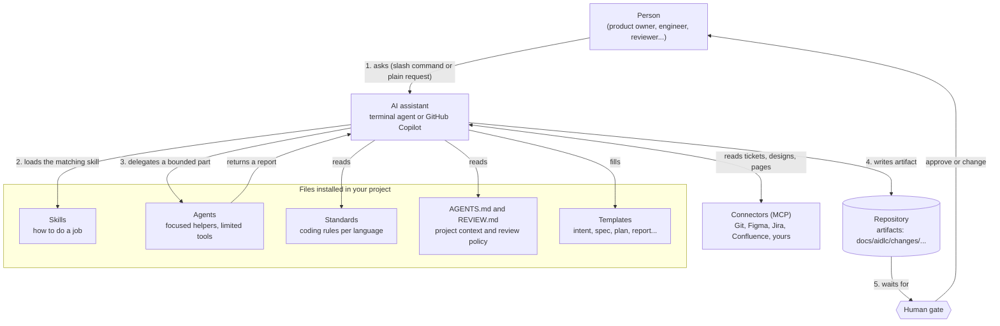
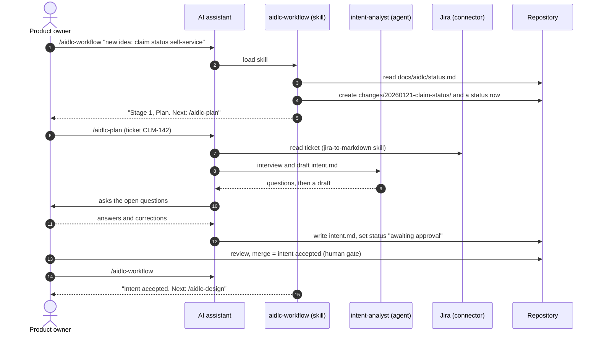

# AIDLC Playbook guide

How the pieces fit together, what each one is for, and how a conversation actually starts.
For the list of every skill and agent, see [REFERENCE.md](REFERENCE.md) (generated, always current).

## 1. The idea in one page

AIDLC (AI-Driven Development Life Cycle) is a way of working in which an AI coding assistant does the drafting and people make the decisions. Work moves through six stages: **Plan, Design, Build, Test, Deploy, Maintain**. Each stage:

1. **reads** the artifact the previous stage committed,
2. **produces** one artifact of its own (a file in the repository),
3. **stops at a human gate**, where a named person accepts or rejects it.

```
intent.md -> spec.md -> plan.md -> code + tests -> review + release -> incident.md -> (new) intent.md
  Plan        Design     Build        Test             Deploy            Maintain
```

The commit history of those files is the audit trail: who asked for what, what the agent produced, who approved it.

**The most important thing to understand:** this playbook is a set of *files*. Nothing in it runs by itself. Skills, agents, standards, and templates are Markdown and JSON that an AI assistant reads when a person asks it to do something. The assistant (a terminal AI agent, or GitHub Copilot in VS Code) is the thing that acts; the playbook tells it how to act, in what order, with which rules, and where it must stop.

## 2. The parts and how they relate



Plain-language version: a person asks the assistant for something. The assistant finds the right **skill** (instructions), reads the relevant **standards** and **project context**, may hand a bounded piece of work to an **agent**, may reach other systems through **connectors**, and writes the result as an **artifact** in the repository. Then it stops, and a person decides.

## 3. The roles, one by one

### 3.1 The orchestrator (`aidlc-workflow`)
The orchestrator is a **skill**, not a running program. It is the one that answers "where are we, and what next?".

- It reads and maintains `docs/aidlc/status.md`: one row per change with its stage, status (`draft`, `awaiting approval`, `accepted`, `blocked`), what it is waiting on, and who must act.
- It starts a change (creates `docs/aidlc/changes/<date>-<slug>/`), reports where every change stands, and recommends the next skill.
- It never marks a gate accepted. Only a person does.
- It records overrides, for example a stage started before the previous one was accepted, with the reason.
- It is the only skill that is always installed, even when a user picks a small subset.

It **recommends** the next skill; it does not run the whole life cycle on its own. A person (or a script you add) starts each next step.

### 3.2 Skills
A skill is a Markdown file (`SKILL.md`) with a short description of *when to use it* and numbered steps for *what to do*. The assistant loads it when it matches the request or when the person types its name as a slash command. There are 91, in these kinds:

| Kind | Purpose | Examples |
|---|---|---|
| **Stage skills** | Drive one AIDLC stage end to end and produce its artifact | `aidlc-plan` makes `intent.md`; `aidlc-design` makes `spec.md`; `aidlc-build` makes `plan.md` then code; `aidlc-test`, `aidlc-deploy`, `aidlc-maintain` |
| **Specialist skills** | Do one job inside a stage | `grounded-research`, `generate-meeting-minutes`, `jira-to-markdown` (Plan); `threat-modeling`, `api-design` (Design); `analyze-repository`, `impact-analysis`, `knowledge-index`, `knowledge-graph`, `cobol-development` (Build); `unit-test-generation`, `performance-test` (Test); `ci-cd-pipeline`, `release-readiness-review` (Deploy); `incident-response`, `root-cause-analysis` (Maintain) |
| **Foundation skills** | Set up the rules the others rely on | `aidlc-project-context` (`AGENTS.md`), `aidlc-review-policy` (`REVIEW.md`), `aidlc-policy-skill`, `aidlc-guardrails`, `aidlc-evals`, `aidlc-metrics`, `aidlc-connectors` |
| **Git skills** | Work with branches, pull requests, and reviews | `git-commit`, `git-create-pr`, `git-review-pr`, `git-pr-comment`, `git-resolve-pr-conflicts`, `git-release-notes` |
| **Standards-driven skills** | Apply the language standards | `code-review`, `cobol-development` |

A skill is **advisory**: it makes the assistant very likely to follow the process, but it does not force it. Rules that must *always* hold need something deterministic behind them (a required CI check, branch protection, a protected-paths guard). That is what `aidlc-guardrails` and the templates in `docs/aidlc/guards/` and `docs/aidlc/templates/ci/` are for.

### 3.3 Agents
An agent is a Markdown file that defines a **focused helper with limited tools**. The difference from a skill:

- A **skill** says *how to do a job*. It runs inside the main conversation.
- An **agent** is *who does a bounded part of the job*, in its own context, with only the tools it needs.

Why bother: limited tools are a safety feature, and a separate context keeps the main conversation focused and keeps a verdict independent.

| Agent | Tools | Why it is restricted |
|---|---|---|
| `intent-analyst`, `spec-author` | read, search, edit | Draft artifacts in the change folder only |
| `planner`, `researcher` | read, search | Cannot change anything: planning and exploring are safe by construction |
| `code-simplifier` | read, search, edit, execute | Edits after the work passes; must revert if checks fail |
| `verifier` | read, execute | Runs the app and checks in a fresh context and **reports only**; it cannot fix, so its verdict is not shaded by the author's assumptions |
| `reviewer` | read, search, execute | Reviews against the standards; **cannot edit or approve**, so the author never approves their own code |
| `release-coordinator` | read, search, edit, execute | Prepares everything up to the production gate and stops |
| `incident-diagnostician` | read, search, execute | Diagnoses read-only; proposes only through a pull request or an approved runbook |
| `confidence-gate` | read, search, execute | Adversarial check that decides continue or escalate |

Agents do not talk to each other and do not start themselves. The **main assistant session calls an agent**, waits, and receives its written report. (Mapping: `aidlc-plan` uses `intent-analyst`; `aidlc-design` uses `spec-author`; `aidlc-build` uses `planner`, `researcher`, `code-simplifier`; `aidlc-test` uses `verifier`; `aidlc-deploy`, `code-review`, and `git-review-pr` use `reviewer`; `aidlc-deploy` uses `release-coordinator`; `aidlc-maintain` uses `incident-diagnostician` and `confidence-gate`.)

### 3.4 Standards (`standards/`)
One document per language or framework, with numbered rules and default severities (for example `JAVA-005 (Important)`). The `code-review` skill and the `reviewer` agent read `docs/aidlc/standards/index.md`, match the changed files to documents, and cite rule IDs in findings. See [section 6](#6-what-each-folder-is-for).

### 3.5 Connectors (MCP servers)
Connectors let the assistant read and write systems outside the repository: Git, Figma, Jira, Confluence, and a slot for company-specific ones. They are the assistant's hands in other tools. The `aidlc-connectors` skill defines what each may read and write, and when. Reads come first; writes need confirmation and a named approver.

### 3.6 Artifacts and templates
Artifacts are the Markdown files each stage commits, such as `intent.md`, `spec.md`, `plan.md`. Templates (`docs/aidlc/templates/`) are the empty forms the skills fill in. **Artifacts are how stages communicate**: stage N does not message stage N+1; it commits a file, and stage N+1 reads it.

### 3.7 Catalog (`catalog/catalog.json`)
Not part of what the assistant reads. It is a build-time index: which group each skill and agent belongs to, and which skills each role preset contains. The website filters, the role picker, and the generated data all come from it, and the build fails if a skill is missing from it.

## 4. How communication starts

### 4.1 Who talks to whom

| From | To | How |
|---|---|---|
| Person | Assistant | A slash command (`/aidlc-workflow`) or a plain request ("review this PR for our Java standards") |
| Assistant | Skill | Loads the `SKILL.md` that matches the command or request |
| Assistant | Files | Reads `status.md`, earlier artifacts, `AGENTS.md`, `REVIEW.md`, standards |
| Assistant | Agent | Delegates a bounded task; the agent works alone and returns a report |
| Assistant | Connector | Tool calls to Jira, Figma, Confluence, Git; reads first, writes with confirmation |
| Assistant | Repository | Writes the artifact into `docs/aidlc/changes/<id>/` |
| Stage to stage | via files only | The next stage reads the committed artifact |
| Person | Gate | Accepts, edits, or rejects; recorded in `status.md` and the pull request |

Nothing starts without a person (see 4.3 for the one exception you can add).

### 4.2 A conversation, step by step



In words:

1. **A person starts it.** They open the project in the assistant and type `/aidlc-workflow`, or just describe the work.
2. **The orchestrator reads the state** (`status.md`), creates the change folder if it is new, and says which stage is next.
3. **The person runs the stage skill** (`/aidlc-plan`). The skill tells the assistant what to read, which questions to ask, which template to fill, and which agent or connector to use.
4. **The assistant works**, possibly delegating to an agent and reading Jira or Figma, and writes the artifact.
5. **The assistant stops** and sets the change to `awaiting approval`.
6. **A person approves** (typically by merging a pull request or recording it in `status.md`). Only then does the orchestrator report the next stage.

### 4.3 The three ways a conversation can start

1. **A slash command.** `/aidlc-plan`, `/code-review`, `/git-create-pr`. The assistant loads that exact skill. Works in the terminal agent and in Copilot Chat.
2. **A plain request.** "Review this branch against our standards." The assistant matches the request to a skill description (that is why every skill starts with a "Use when..." description) and loads it. The slash command is more reliable; plain requests depend on the assistant choosing correctly.
3. **An automated trigger (optional, not built in).** The Maintain design is that a script watches a metric, and when a control band is breached it starts the assistant non-interactively to diagnose and write a new `intent.md`. This repository ships the *pieces* (`docs/aidlc/monitoring/bands.yaml`, CI gate templates, the `incident-diagnostician` and `confidence-gate` agents, the `aidlc-maintain` skill) but **not** the running trigger. You would add it in your CI or scheduler. Until then, a person starts Maintain too.

### 4.4 Example: a developer reviews code

1. Developer types `/code-review` on a branch that changes `OrderService.java` and `pom.xml` (Spring Boot).
2. The skill reads `docs/aidlc/standards/index.md`, matches `*.java` and the Spring Boot build file, and loads `java.md` and `spring-boot.md` (Spring Boot also loads Java).
3. It reads `REVIEW.md` and, if present, the change's `spec.md` and `plan.md`.
4. It reviews only the changed code and reports findings such as `JAVA-005 (Important) OrderService.java:88 ...`, with a fix for each.
5. It offers to post the review with `git-review-pr`. A human code owner still decides whether to approve.

### 4.5 Example: a business analyst starts from a ticket
`/jira-to-markdown` (ticket becomes a source file) → `/generate-meeting-minutes` (workshop notes) → `/requirements-gap-analysis` → `/aidlc-plan` (draft `intent.md`) → product owner accepts. The analyst installed only the Plan skills plus the orchestrator, using the **Business analyst** role in the picker.

## 5. What is enforced and what is advice

| Mechanism | Strength | Where |
|---|---|---|
| Skill instructions | Advisory: likely followed, not guaranteed | `skills/` |
| Agent tool limits | Enforced by the assistant: a read-only agent cannot edit | `agents/` |
| `status.md` and the orchestrator | Process tracking, depends on people recording approvals | `docs/aidlc/status.md` |
| Branch protection, required CI checks, protected-paths guard | **Deterministic** | `docs/aidlc/guards/`, `docs/aidlc/templates/ci/` (templates you must turn on) |
| Review findings | Inform a person; never approve or block alone | `REVIEW.md` |

If a rule must hold every time, put it in branch protection or CI, not only in a skill.

## 6. What each folder is for

```
aidlc-playbook/
  skills/       91 skills. One folder each with SKILL.md. SOURCE OF TRUTH.
  agents/       10 agent definitions (neutral tool capabilities). SOURCE OF TRUTH.
  standards/    Coding standard per language + index.md + _template.md. SOURCE OF TRUTH.
  mcp/          Connector definitions (servers/*.json) + README. SOURCE OF TRUTH.
  templates/    Files copied into user projects (docs/aidlc/*, AGENTS.md, REVIEW.md, evals/).
  catalog/      catalog.json: groups, role presets (build-time index).
  installers/   install.ps1 (Windows) and install.sh (macOS, Linux).
  scripts/      Build and generator scripts.
  docs/         This guide, the generated reference, README diagrams.
  web/          Angular 21 website (tabs, picker, downloads).
  aidlc.pdf     The reference playbook this design is based on.
```

| Folder | What it is | Who edits it | How it reaches users |
|---|---|---|---|
| `skills/` | The instructions the assistant follows. Tool-neutral Markdown | Playbook maintainers | Copied into `.claude/skills` and `.github/skills` (and `.github/prompts`) by the generator |
| `agents/` | Helper definitions with neutral capabilities `read, search, edit, execute` | Maintainers | Converted to each assistant's agent format (`.claude/agents`, `.github/agents`) |
| `standards/` | Rules per language, with rule IDs and severities | Language owners | Installed to `docs/aidlc/standards/`; never overwritten, so local overrides survive |
| `mcp/` | One JSON per connector, plus `_company-template.json` for your own | Platform team | Turned into `.mcp.json` and `.vscode/mcp.json`; created only if missing; no secrets stored |
| `templates/` | The forms and starter files: artifact templates, `AGENTS.md`, `REVIEW.md`, guard script, CI templates, `bands.yaml`, evals | Maintainers | Copied into the project; project-owned files are created only if missing |
| `catalog/` | Groups and role presets | Maintainers | Read at build time to generate the website data; not installed |
| `installers/` | The scripts users run. Verify the checksum, install the bundle, support `--skills` and `--agents` subsets, merge instead of overwrite | Maintainers | Published in `web/public/downloads/` |
| `scripts/` | See below | Maintainers | Build time only |
| `docs/` | Documentation about the playbook itself | Maintainers | Not installed (users get `docs/aidlc/` from `templates/`) |
| `web/` | The Angular site: Introduction, Journey, Installation, Skills, Docs, Get Started | Maintainers | Deployed as a static site |

### Scripts

| Script | Purpose |
|---|---|
| `sync-skills.mjs` | Generates the assistant-specific folders from `skills/`, `agents/`, `mcp/` into a target project (`--tool agent`, `copilot`, or `all`) |
| `build-downloads.mjs` | Builds the zip bundles, checksums, and installers into `web/public/downloads/`, validates the catalog, and generates the website's skill data. Runs automatically before `npm start` and `npm run build` |
| `generate-reference.mjs` | Generates `docs/REFERENCE.md` from the real files |
| `generate-readme-diagrams.mjs` | Draws the circular loop and architecture diagrams for the README |
| `generate-phase-diagram.mjs`, `generate-tab-images.mjs`, `generate-figures.mjs` | Draw the website's illustrations as SVG |
| `lib/svg.mjs` | Shared drawing helpers for the generators |

### What ends up in a user's project

```
.claude/skills/  .claude/agents/                   terminal agent
.github/skills/  .github/agents/  .github/prompts/ GitHub Copilot (+ a block in copilot-instructions.md)
.mcp.json        .vscode/mcp.json                  connectors
AGENTS.md  REVIEW.md                               project context, review policy
docs/aidlc/                                        README, status.md, templates/, standards/, guards/, monitoring/, mcp/, policies/
evals/                                             regression tests for agent configuration
```

The `.claude` folder name is simply the folder that one assistant reads. Everything authored in this repository stays tool-neutral.

## 7. The path from source to a user's machine

```
edit skills/ agents/ standards/ mcp/ templates/ catalog/
        |
node scripts/build-downloads.mjs     (validate catalog, generate web data, build zips + checksums)
        |
cd web && npm run build              (Angular site with downloads/ inside)
        |
deploy the static site over HTTPS
        |
user: Installation page -> picks role/skills -> copies 2 commands
        |
install.ps1 / install.sh             (download zip, verify SHA-256, keep only the picked skills, merge, never overwrite project-owned files)
        |
user opens the project in the assistant and types /aidlc-workflow
```

## 8. Honest limits

- **Nothing here has been run inside a real assistant by the authors of this repository.** The skills, agents, and standards were written from general practice and should be piloted and reviewed.
- **Skills are advice.** Turn on the CI and branch-protection templates for anything that must always hold.
- **Agent support varies.** Both assistants read agent definitions, but how and when each one delegates to them depends on the product version and your organization's settings. Check in your VS Code and terminal-agent versions.
- **Connector package names and endpoints** must be verified with your security team before rollout.
- **Automated triggers are not included.** Maintain's autonomous loop needs a scheduler or CI job that you add.
- **The coding standards are a baseline**, not an approved company standard. Language owners should review them and record local overrides.
- **Regulated data** (GDPR, HIPAA, PCI-DSS): consult your Data Privacy Officer before using an assistant on it. Review AI output before sharing it externally.

## 9. Quick answers

**Is the orchestrator a program that runs the stages?** No. It is a skill that tracks state in `status.md` and recommends the next step. People (or a script you add) start each step.

**Do agents call other agents?** No. The main assistant calls them and gets reports back.

**Can I run any skill at any time?** Yes. Stage order is guidance, enforced by the orchestrator's tracking, human gates, and any CI checks you enable. Overrides are recorded.

**Do I need all 91 skills?** No. Pick a role or tick individual skills on the Installation page. The orchestrator is always included.

**How do I add a skill?** Create `skills/<name>/SKILL.md`, add one line to `catalog/catalog.json`, run `node scripts/build-downloads.mjs` and `node scripts/generate-reference.mjs`.

**How do I add a language standard?** Copy `standards/_template.md`, add a row to `standards/index.md`, and have a language owner approve it.

**How do I add our own connector?** Copy `mcp/servers/_company-template.json` and follow `mcp/README.md`.
